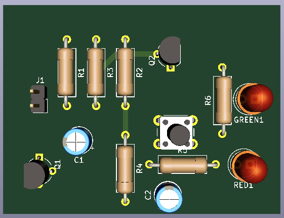
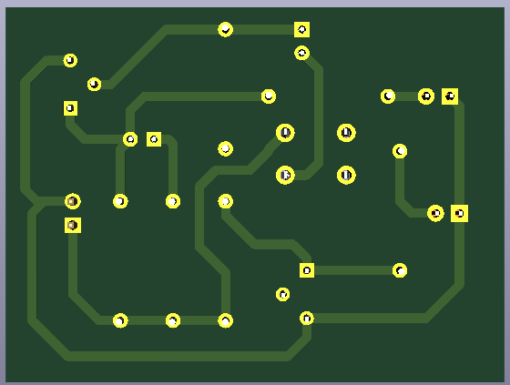
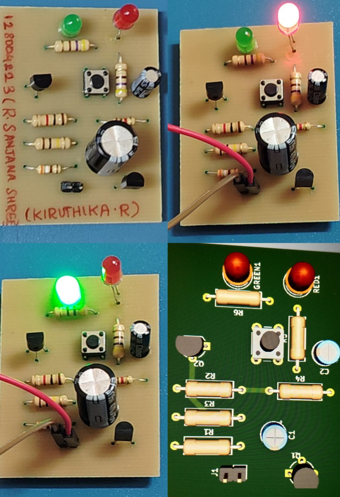

# Monostable Multivibrator-Based Timer Circuit

## Project Overview

This project focuses on the design and fabrication of a timer circuit based on the monostable multivibrator concept.

It was developed as part of my Electronics Manufacturing Systems (EMS) certification course during my undergraduate studies in Electronics and Communication Engineering.

The circuit was designed using KiCad and physically fabricated as a PCB. Red and green LEDs are used as visual indicators to demonstrate the circuit's operation.

## Project Objectives

- Understand the working principle of a monostable multivibrator.
- Apply theoretical electronics concepts to practical circuit design.
- Develop the circuit schematic using KiCad.
- Design and fabricate a PCB.
- Gain hands-on experience in electronic component assembly and hardware implementation.

## Components Used

- BC547 NPN transistors
- Resistors
- Capacitors
- Red and green LEDs
- Push-button switch
- Power connector

## Software and Tools

- **KiCad:** Schematic capture and PCB layout design.
- **Component Search Engine:** Component identification and selection.
- **PCB Layout Printing Machine:** PCB layout printing.

## PCB Design and Visualization

### 3D Front View

### 3D Rear View

### Fabricated Hardware

## Design and Fabrication Process

1. **Circuit Concept:** Studied the working principle of the monostable multivibrator and applied it to the timer circuit design.

2. **Schematic Design:** Developed the circuit schematic using KiCad, performed Design Rule Check (DRC), assigned component footprints, and generated the Netlist and Bill of Materials (BOM).

3. **PCB Layout Design:** Imported the generated Netlist into the PCB layout editor. Adjusted track widths based on the available pogo-pin specifications, completed component placement and routing, and examined the board using the 3D viewer.

4. **PCB Fabrication:** Proceeded with PCB fabrication using the available laboratory equipment and processes.

5. **Hardware Assembly and Testing:** Assembled the electronic components on the fabricated PCB and observed the circuit operation.

## Potential Application

The timer circuit can be adapted into an alarm circuit by replacing an LED indicator with a suitable buzzer. This modification would provide an audible indication when the circuit is triggered.

## Learning Outcomes

- Practical understanding of monostable multivibrator circuits.
- Experience in electronic schematic design using KiCad.
- Understanding of Design Rule Checks, footprint assignment and Netlist generation.
- Hands-on experience in PCB layout, routing and 3D visualization.
- Practical exposure to PCB fabrication and hardware assembly.

## Acknowledgment

This project was completed as part of my Electronics Manufacturing Systems certification course under the guidance of my laboratory instructor. I am grateful for the guidance and support provided throughout the design and fabrication process.
